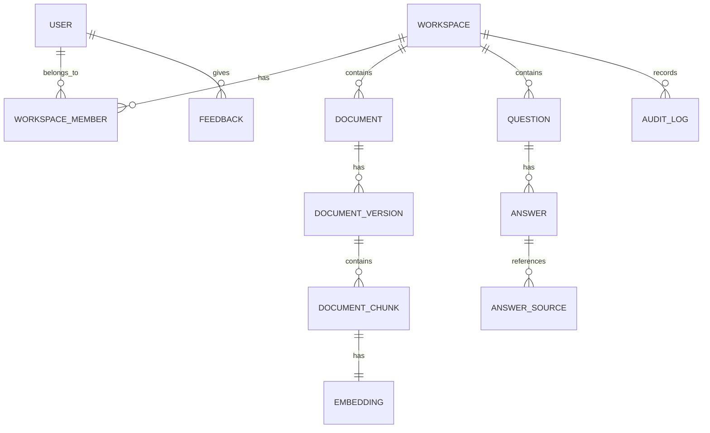

# Engineering Knowledge Assistant
## Database Design Document

---

## 1. Database Choice

Use:

```text
PostgreSQL + pgvector
```

PostgreSQL stores normal application data, while pgvector stores embeddings and supports similarity search.

---

## 2. Core Entities

```text
User
Workspace
WorkspaceMember
Document
DocumentVersion
DocumentChunk
IngestionJob
Question
Answer
AnswerSource
Feedback
AuditLog
```

---

## 3. Entity Relationships

```text
User 1 ─── many WorkspaceMembers
Workspace 1 ─── many WorkspaceMembers
Workspace 1 ─── many Documents
Document 1 ─── many DocumentVersions
DocumentVersion 1 ─── many DocumentChunks
DocumentChunk 1 ─── 1 Embedding
Workspace 1 ─── many Questions
Question 1 ─── many Answers
Answer 1 ─── many AnswerSources
User 1 ─── many Feedbacks
Workspace 1 ─── many AuditLogs
```

---

## 4. Entity Relationship Diagram



---

## 5. Initial Migration

Create:

```text
backend/src/main/resources/db/migration/V1__init.sql
```

```sql
CREATE EXTENSION IF NOT EXISTS vector;

CREATE TABLE users (
    id UUID PRIMARY KEY DEFAULT gen_random_uuid(),
    email VARCHAR(255) UNIQUE NOT NULL,
    password_hash VARCHAR(255) NOT NULL,
    full_name VARCHAR(255) NOT NULL,
    created_at TIMESTAMPTZ NOT NULL DEFAULT now(),
    updated_at TIMESTAMPTZ NOT NULL DEFAULT now()
);

CREATE TABLE workspaces (
    id UUID PRIMARY KEY DEFAULT gen_random_uuid(),
    name VARCHAR(255) NOT NULL,
    slug VARCHAR(255) UNIQUE NOT NULL,
    owner_id UUID NOT NULL REFERENCES users(id),
    created_at TIMESTAMPTZ NOT NULL DEFAULT now(),
    updated_at TIMESTAMPTZ NOT NULL DEFAULT now()
);

CREATE TABLE workspace_members (
    id UUID PRIMARY KEY DEFAULT gen_random_uuid(),
    workspace_id UUID NOT NULL REFERENCES workspaces(id) ON DELETE CASCADE,
    user_id UUID NOT NULL REFERENCES users(id) ON DELETE CASCADE,
    role VARCHAR(50) NOT NULL,
    created_at TIMESTAMPTZ NOT NULL DEFAULT now(),
    UNIQUE (workspace_id, user_id)
);
```

---

## 6. Document Tables Migration

Create:

```text
V2__documents.sql
```

```sql
CREATE TABLE documents (
    id UUID PRIMARY KEY DEFAULT gen_random_uuid(),
    workspace_id UUID NOT NULL REFERENCES workspaces(id) ON DELETE CASCADE,
    title VARCHAR(255) NOT NULL,
    source_type VARCHAR(50) NOT NULL,
    current_version_id UUID,
    created_by UUID NOT NULL REFERENCES users(id),
    created_at TIMESTAMPTZ NOT NULL DEFAULT now(),
    updated_at TIMESTAMPTZ NOT NULL DEFAULT now()
);

CREATE TABLE document_versions (
    id UUID PRIMARY KEY DEFAULT gen_random_uuid(),
    document_id UUID NOT NULL REFERENCES documents(id) ON DELETE CASCADE,
    workspace_id UUID NOT NULL REFERENCES workspaces(id) ON DELETE CASCADE,
    version_number INT NOT NULL,
    file_key VARCHAR(500) NOT NULL,
    file_name VARCHAR(255) NOT NULL,
    mime_type VARCHAR(100) NOT NULL,
    file_size BIGINT NOT NULL,
    status VARCHAR(50) NOT NULL,
    uploaded_by UUID NOT NULL REFERENCES users(id),
    created_at TIMESTAMPTZ NOT NULL DEFAULT now()
);

CREATE TABLE document_chunks (
    id UUID PRIMARY KEY DEFAULT gen_random_uuid(),
    document_version_id UUID NOT NULL REFERENCES document_versions(id) ON DELETE CASCADE,
    workspace_id UUID NOT NULL REFERENCES workspaces(id) ON DELETE CASCADE,
    chunk_index INT NOT NULL,
    content TEXT NOT NULL,
    token_count INT,
    page_number INT,
    embedding vector(1536),
    created_at TIMESTAMPTZ NOT NULL DEFAULT now()
);

CREATE TABLE ingestion_jobs (
    id UUID PRIMARY KEY DEFAULT gen_random_uuid(),
    document_version_id UUID NOT NULL REFERENCES document_versions(id) ON DELETE CASCADE,
    workspace_id UUID NOT NULL REFERENCES workspaces(id) ON DELETE CASCADE,
    status VARCHAR(50) NOT NULL,
    attempts INT NOT NULL DEFAULT 0,
    error_message TEXT,
    started_at TIMESTAMPTZ,
    completed_at TIMESTAMPTZ,
    created_at TIMESTAMPTZ NOT NULL DEFAULT now()
);
```

---

## 7. Question and Answer Tables

Create:

```text
V3__questions_answers.sql
```

```sql
CREATE TABLE questions (
    id UUID PRIMARY KEY DEFAULT gen_random_uuid(),
    workspace_id UUID NOT NULL REFERENCES workspaces(id) ON DELETE CASCADE,
    user_id UUID NOT NULL REFERENCES users(id),
    question_text TEXT NOT NULL,
    created_at TIMESTAMPTZ NOT NULL DEFAULT now()
);

CREATE TABLE answers (
    id UUID PRIMARY KEY DEFAULT gen_random_uuid(),
    question_id UUID NOT NULL REFERENCES questions(id) ON DELETE CASCADE,
    answer_text TEXT NOT NULL,
    model VARCHAR(100),
    status VARCHAR(50) NOT NULL,
    created_at TIMESTAMPTZ NOT NULL DEFAULT now()
);

CREATE TABLE answer_sources (
    id UUID PRIMARY KEY DEFAULT gen_random_uuid(),
    answer_id UUID NOT NULL REFERENCES answers(id) ON DELETE CASCADE,
    document_id UUID NOT NULL REFERENCES documents(id),
    document_version_id UUID NOT NULL REFERENCES document_versions(id),
    document_chunk_id UUID NOT NULL REFERENCES document_chunks(id),
    similarity_score DOUBLE PRECISION,
    excerpt TEXT NOT NULL,
    created_at TIMESTAMPTZ NOT NULL DEFAULT now()
);

CREATE TABLE feedback (
    id UUID PRIMARY KEY DEFAULT gen_random_uuid(),
    answer_id UUID NOT NULL REFERENCES answers(id) ON DELETE CASCADE,
    user_id UUID NOT NULL REFERENCES users(id),
    rating VARCHAR(50) NOT NULL,
    comment TEXT,
    created_at TIMESTAMPTZ NOT NULL DEFAULT now(),
    UNIQUE (answer_id, user_id)
);

CREATE TABLE audit_logs (
    id UUID PRIMARY KEY DEFAULT gen_random_uuid(),
    workspace_id UUID REFERENCES workspaces(id) ON DELETE SET NULL,
    actor_id UUID REFERENCES users(id),
    action VARCHAR(100) NOT NULL,
    entity_type VARCHAR(100) NOT NULL,
    entity_id UUID,
    metadata JSONB,
    created_at TIMESTAMPTZ NOT NULL DEFAULT now()
);
```

---

## 8. Indexes

```sql
CREATE INDEX idx_workspace_members_workspace ON workspace_members(workspace_id);
CREATE INDEX idx_workspace_members_user ON workspace_members(user_id);
CREATE INDEX idx_documents_workspace ON documents(workspace_id);
CREATE INDEX idx_document_versions_document ON document_versions(document_id);
CREATE INDEX idx_document_chunks_version ON document_chunks(document_version_id);
CREATE INDEX idx_document_chunks_workspace ON document_chunks(workspace_id);
CREATE INDEX idx_ingestion_jobs_workspace ON ingestion_jobs(workspace_id);
CREATE INDEX idx_questions_workspace ON questions(workspace_id);
CREATE INDEX idx_answers_question ON answers(question_id);
CREATE INDEX idx_answer_sources_answer ON answer_sources(answer_id);

CREATE INDEX idx_document_chunks_embedding
ON document_chunks
USING ivfflat (embedding vector_cosine_ops)
WITH (lists = 100);
```

---

## 9. Status Values

### Document Status

```text
UPLOADED
PROCESSING
READY
FAILED
ARCHIVED
```

### Ingestion Job Status

```text
QUEUED
RUNNING
COMPLETED
FAILED
RETRYING
```

### Workspace Member Role

```text
ADMIN
EDITOR
MEMBER
```

### Feedback Rating

```text
HELPFUL
UNHELPFUL
```

---

## 10. Important Rules

- Every workspace-scoped table must include `workspace_id`.
- Every query must filter by the current workspace.
- Never store plain-text passwords.
- Use Flyway migrations; do not create tables manually.
- Use foreign keys.
- Use transactions for multi-step writes.
- Store embedding dimension consistently, for example `vector(384)` or `vector(1536)`.
- The embedding column dimension must match the embedding model.
